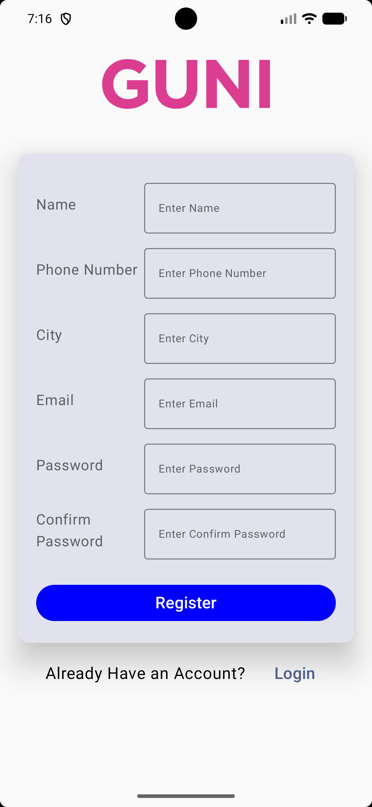

# Practical-5 : Login and Registration using Jetpack Compose

## Aim
To create an Android application that includes Login and Registration screens using Jetpack Compose.

## Overview
This practical demonstrates how to design Login and Registration screens using **Jetpack Compose**, a modern UI toolkit for Android development. It uses composable functions to create the user interface and manage user interactions.

## What We Did
- Created a Login screen with input fields for user credentials.
- Designed a Registration screen for entering user details.
- Used Jetpack Compose components to build the UI.
- Implemented navigation between Login and Registration screens.
- Added buttons and text fields to accept user input.

## How We Did It
1. Created an Android project in Android Studio using Kotlin.
2. Configured Jetpack Compose in the project.
3. Designed the Login screen using composable functions and text fields.
4. Created the Registration screen with the required input fields.
5. Added buttons and click events to switch between the screens.
6. Ran the application on an emulator or Android device to test the UI.

## Technologies Used
- Android Studio
- Kotlin
- Jetpack Compose
- Material Design Components

## Student Information

- **Enrollment No.:** 24012011134
- **Department:** Computer Engineering
- **Subject:** Mobile Application Development

---

---

---

## Output

### Login Screen

### Registration Screen

